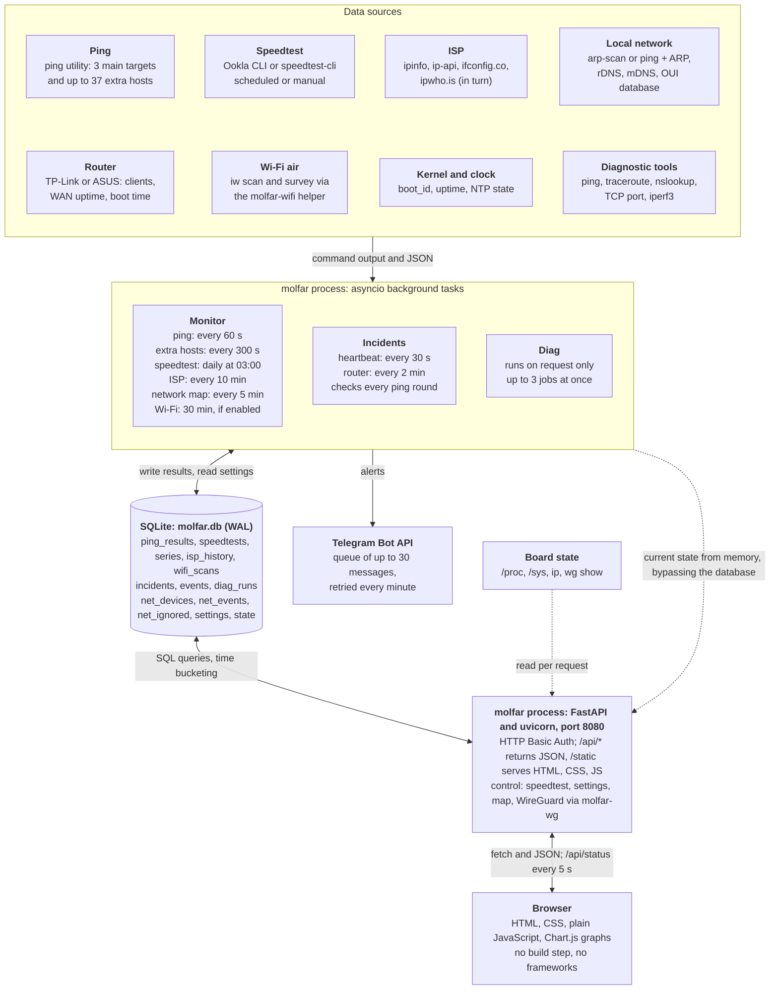

[Українська](ARCHITECTURE.ukr.md) | **English**

# Molfar: architecture

## Overview

Molfar consists of one Python process and one SQLite file. That process runs both the background tasks that collect measurements and the web server that displays them, so there are no separate workers, message broker or database server.

This description is based on the code of the `main` branch (commit `3bbf722` of 4 November 2026) for `advanced-version`. Differences in the other versions are listed at the end.

The main data path runs top to bottom: external command or service, background task, SQLite table, API request, graph in the browser. There are two exceptions. The API takes current state (last ping, series progress, next check time) directly from process memory, and it reads temperature, memory and WireGuard state at request time, so none of these reach the database.

## Where the data comes from

The service has almost no drivers or network protocols of its own: it runs system utilities without a shell and parses their output, or calls external services. Modules in the table are relative to `molfar/molfar/`.

| Data | Source | How it is obtained | Module |
| --- | --- | --- | --- |
| Loss, RTT, jitter | `ping` utility | `ping -n -c 20 -i 0.2 -W 2`; output is parsed with regular expressions. Jitter is the mean absolute difference between consecutive RTTs | `probes.py` |
| Speed | Ookla CLI or `speedtest-cli` | Run with JSON output. The `auto` engine picks Ookla if it is installed. Ookla also reports jitter and loss; `speedtest-cli` does not measure them | `probes.py` |
| ISP, external IP, ASN | ipinfo.io, ip-api.com, ifconfig.co, ipwho.is | HTTP requests in turn until the first successful answer. ISPs are compared by ASN, and a change is confirmed by a repeat check after 20 s | `isp.py` |
| Devices on the local network | `arp-scan`, with `ping` and `ip neigh` as a fallback | Subnet scan (at most /22), names via rDNS and mDNS, vendor from the OUI database, device type guessed from vendor and name | `netscan.py`, `netmap.py` |
| Router clients | TP-Link (`tplinkrouterc6u`), ASUS (`asusrouter`) | Login to the router API: clients by band, boot time (ASUS) or WAN uptime (TP-Link). The README marks this feature as not yet tested | `routers.py` |
| Neighbouring Wi-Fi networks | `iw scan`, `iw survey dump` | Through the root helper `molfar-wifi`; without it, the kernel's `scan dump` cache is used. The spectrum is modelled, not measured: from each network's RSSI, channel width and the 802.11 OFDM mask | `wifi.py` |
| Temperature, memory, disk, IP | `/sys/class/thermal`, `/proc`, `ip addr` | Read during an `/api/status` request | `sysinfo.py` |
| WireGuard state | `wg show all dump` | Read per request, cached for 15 s | `sysinfo.py` |
| Reboots and downtime | `/proc/sys/kernel/random/boot_id`, `/proc/uptime`, `adjtimex` | Compares `boot_id` with the stored value and checks clock synchronisation | `incidents.py` |
| Diagnostics | `ping`, `traceroute`, `nslookup`, TCP connection, `iperf3` | Only on user request; output is delivered live | `diag.py` |

## How data reaches the database

At startup `app.py` creates the `DB`, `Monitor`, `Auth` and `Diag` objects, and `Monitor.start()` launches nine asyncio background loops in the same event loop as the web server. Each loop re-reads settings from the database on every pass, so changes made in the web interface apply without a restart. Blocking operations (network scan, Wi-Fi, HTTP requests to ISP lookup services) run in separate threads.

| Loop | Default interval | What it writes | Where |
| --- | --- | --- | --- |
| `_ping_loop` | 60 s | One row per main target and per host shown on the Overview | `ping_results` |
| `_ping_extra_loop` | 300 s | The same for the remaining extra hosts, up to 10 concurrent pings | `ping_results` |
| `_schedule_loop` | Checks every 20 s, starts daily at 03:00 | A series of 5 tests with 5 min pauses | `series`, `speedtests` |
| `_isp_loop` | 10 min | A row only on first detection or when the ISP or IP changes; the current value is updated every time | `isp_history`, `state` |
| `_netmap_loop` | 5 min | Merges the scan into the map in one transaction | `net_devices`, `net_events` |
| `_wifi_loop` | 30 min, off by default | Air snapshot and channel scores as JSON | `wifi_scans` |
| `heartbeat_loop` | 30 s | Time and `boot_id` | `state` |
| `router_loop` | 2 min, if a router is configured | Router failures and Wi-Fi drops; the clients themselves stay in memory | `incidents` |
| `_maintenance_loop` | 60 s | Flushes the Telegram queue; every 6 hours deletes old records | deletion |

### Ping

1. `ping_round` pings all targets concurrently through `probes.ping_target`.
2. Each result is written to `ping_results` and to `last_ping` in memory, which feeds the Overview tile.
3. `_check_loss_alerts` checks the loss threshold and queues an alert if needed.
4. `inc.on_ping` evaluates the main targets and opens or closes an `internet` incident.

By default ping pauses during a speedtest so that the load does not look like packet loss.

### Speedtest

1. `start_series` creates a row in `series` with status `running`.
2. Each test adds a row to `speedtests`, even a failed one, in which case the `error` field is filled. If the selected server is unavailable, the test is repeated with automatic server selection.
3. `_finish_series` averages the successful tests and updates the series row.

To prevent two runs in one day, the date of the last run is stored in `state`. A run can start within a 15-minute window after the set time, so a brief service restart does not lose the series. Series left `running` after a crash are marked `stopped` at startup.

### Network map

A device is identified by its MAC address. `apply_scan` adds new devices and records IP changes and online and offline transitions, but leaves fields the user has locked untouched. A device goes offline after 15 min without a response, and after 7 days offline it disappears from the map: the row stays in the database with `hidden=1`.

### Other writes

- **Settings:** `POST /api/settings` validates types and value limits and stores each key as a separate row. Keys missing from the database come from `DEFAULTS` in `db.py`.
- **Log:** `db.log()` adds a row to `events` in the interface language at the time of the event.
- **Diagnostics:** live output stays in memory; on completion the summary and up to 64 KB of output are written to `diag_runs`.

All modules use one file in WAL mode. The `DB` class holds one connection protected by a thread lock and commits each write separately; the network map has its own connection and transactions.

## Database structure

The database is one SQLite file whose path is set by `MOLFAR_DB` (default `/var/lib/molfar/molfar.db`). Tables are created at startup with `CREATE TABLE IF NOT EXISTS`, and `_migrate()` adds new columns, so updates keep existing data. Most tables store time as Unix time in seconds.

| Table | What it stores | Written by | Retention |
| --- | --- | --- | --- |
| `ping_results` | One check of one target | `monitor.py` | 400 days |
| `series` | A speedtest series and its averages | `monitor.py` | 400 days |
| `speedtests` | One speed test | `monitor.py` | 400 days |
| `isp_history` | ISP and external IP changes | `monitor.py` | Not cleaned up |
| `incidents` | Failures with start and end | `incidents.py` | Closed: 400 days |
| `events` | Service event log | All modules via `db.log()` | 400 days |
| `net_devices` | Network map devices | `netmap.py` | Hidden after 7 days offline |
| `net_events` | Map log: new device, IP change, online, offline | `netmap.py` | 400 days |
| `net_ignored` | MAC addresses not to show | `netmap.py` | Until removed manually |
| `wifi_scans` | Air snapshot | `wifi.py` | 30 days |
| `diag_runs` | Diagnostics history | `diag.py` | Last 200 records |
| `settings` | Settings, values as JSON | `app.py` | Permanent |
| `state` | Internal state, values as JSON | All modules | Permanent |

The 400-day, 30-day and 7-day periods are defaults and can be changed in the settings.

### Columns

| Table | Columns |
| --- | --- |
| `ping_results` | `id`, `ts`, `target`, `sent`, `received`, `loss`, `rtt_min`, `rtt_avg`, `rtt_max`, `jitter`, `error` |
| `series` | `id`, `started_ts`, `finished_ts`, `trigger`, `status`, `runs_planned`, `runs_ok`, `avg_download`, `avg_upload`, `avg_ping`, `avg_jitter` |
| `speedtests` | `id`, `ts`, `series_id`, `download`, `upload`, `ping`, `jitter`, `packet_loss`, `server`, `engine`, `url`, `error`, `isp`, `external_ip` |
| `isp_history` | `id`, `ts`, `kind`, `ip`, `asn`, `isp`, `org`, `city`, `country`, `source` |
| `incidents` | `id`, `kind`, `started_ts`, `ended_ts`, `details` (JSON) |
| `events` | `id`, `ts`, `level`, `message` |
| `net_devices` | `id`, `mac`, `ip`, `name`, `name_auto`, `kind`, `kind_locked`, `vendor`, `vendor_locked`, `private_mac`, `vlan`, `link`, `link_locked`, `parent_id`, `ssid`, `band`, `note`, `role`, `manual`, `keep`, `status`, `hidden`, `pos_x`, `pos_y`, `first_seen`, `last_seen`, `status_since` |
| `net_events` | `id`, `ts`, `device_id`, `mac`, `name`, `kind`, `type`, `params` (JSON) |
| `net_ignored` | `mac`, `name`, `ts` |
| `wifi_scans` | `id`, `ts`, `iface`, `cached`, `n_bss`, `scores`, `bss`, `survey` (the last three as JSON) |
| `diag_runs` | `id`, `ts`, `tool`, `target`, `params`, `status`, `duration`, `summary`, `output` |
| `settings`, `state` | `key`, `value` (JSON) |

Only `net_devices.mac` has a uniqueness constraint.

### Relationships

There are almost no relationships between tables, because they are independent logs ordered by time. A foreign key is declared only for `speedtests.series_id` → `series.id`. The code maintains two more links: `net_devices.parent_id` → `net_devices.id` (the topology tree) and `net_events.device_id` → `net_devices.id`.

### What `state` holds

| Key | Purpose |
| --- | --- |
| `heartbeat`, `clean_stop` | Tracking Molfar downtime |
| `last_schedule_date` | Date of the last scheduled series |
| `isp_current` | Current ISP |
| `netmap_seeded` | The first scan has happened, so new devices can now be reported |
| `auth_hash` | Hash of a password changed in the web interface |
| `diag_iperf_server` | Whether to restore the iperf3 server after a restart |

There is no pre-aggregation: the database holds raw measurements, and graph averages are computed at request time.

## Web interface and API

**Server.** FastAPI under uvicorn listens on `0.0.0.0:8080` by default, returns JSON on `/api/*` and serves files from `static/`. The automatic OpenAPI documentation is disabled.

**Client.** A single `index.html` page with tabs, written without frameworks or a build step. Graphs are drawn by Chart.js from a local copy in `static/vendor`, so the interface does not depend on a CDN and works without internet access. Translations live in `i18n.js`, server messages in `i18n.py`.

**Data updates.** WebSocket and SSE are not used: the browser polls the API with `fetch`. Updates to Overview, History and Incidents pause while the browser tab is hidden.

| Tab | Requests | Refresh | Data source |
| --- | --- | --- | --- |
| Overview | `GET /api/status` | 5 s | `Monitor` memory, `/proc`, `wg`, latest `series` and `speedtests` rows, incidents for the last day |
| History | `/api/history/ping`, `/api/history/speed`, `/api/isp` | 60 s | `ping_results`, `speedtests`, `series`, `isp_history` |
| Incidents | `/api/incidents` | 30 s | `incidents`, with summaries computed in Python |
| WireGuard | `/api/wg/profiles` | On open and after actions | `/etc/wireguard` via the `molfar-wg` helper |
| Network map | `/api/netmap`, `/api/netmap/events` | 15 s, 3 s during a scan | `net_devices`, `net_events`, `net_ignored` |
| Wi-Fi air | `/api/wifi`, `/api/wifi/history` | 2.5 s during a scan | `wifi_scans`; channel analysis in `wifi.py` |
| Diagnostics | `/api/diag`, `/api/diag/jobs/{id}?since=N` | 0.6–1 s during a job | `Diag` memory, history in `diag_runs` |
| Settings | `GET` and `POST /api/settings` | On open | `settings` |
| Log | `/api/events` | On open | `events` |

### How a history graph is built

`/api/history/ping` groups raw rows into time buckets with an SQL query that accounts for the time zone, and returns average loss, RTT and jitter per target along with a summary for the period.

| Period | Bucket size |
| --- | --- |
| Day | 5 min |
| Week | 1 hour |
| Month | 4 hours |
| Year | 1 day |

`/api/history/speed` returns tests and series without grouping.

### From button to action

- **Start and stop a speedtest:** `POST /api/speedtest/start` and `/stop`.
- **Manual ping:** `POST /api/ping/run`. The result is stored but does not affect alerts or incidents.
- **Editing the map:** `POST`, `PATCH` and `DELETE /api/netmap/devices`.
- **CSV export:** `/api/export/{ping|speed|incidents}.csv`.

After a settings change the API immediately wakes the relevant loops through `asyncio.Event` rather than waiting for their interval.

Browser caching is controlled by a hash: `/` adds `?v=<hash>` to JS and CSS, those files are cached for a year, and `/api/*` is never cached.

## Incidents and alerts

| Type | When it opens | What it records |
| --- | --- | --- |
| `internet` | All public main targets fail 2 checks in a row | The cause, from a gateway ping: `isp` (gateway responds), `lan` (it does not), `nolink` (no route) |
| `molfar` | Recorded at startup if a previous heartbeat exists | The reason: `power`, `reboot`, `restart`, `crash` |
| `router` | 2 failed polls in a row, or a detected restart | Unavailability, reboot, WAN reconnection |
| `wifi` | All Wi-Fi clients vanish between two polls, after at least 2 were connected | How many clients were lost per band |

**How Molfar downtime is determined.** Every 30 s the service stores the time and `boot_id`, and on a clean stop it also stores `clean_stop`. After startup these two signals give the reason:

| | `clean_stop` present | `clean_stop` absent |
| --- | --- | --- |
| `boot_id` changed | `reboot` | `power` |
| `boot_id` unchanged | `restart` | `crash` |

The Orange Pi Zero 3 has no clock battery, so after a reboot the service waits up to 6 hours for NTP synchronisation and restores the start time of open incidents from the monotonic clock.

**Telegram.** Alerts go directly to the Bot API through `urllib` and are off by default. The queue holds up to 30 messages in memory only: without internet the service retries every minute, but a restart loses the queue. The default loss threshold is 10% over 3 checks in a row, with at least 30 min between alerts.

## Security

- **Login:** HTTP Basic Auth on every request, login `admin`, default password `Molfar`. A changed password is stored as a PBKDF2-SHA256 hash.
- **Privileges:** the service runs as the `molfar` user with `CAP_NET_RAW`. Root actions are possible only through `sudo -n` and the rule in `/etc/sudoers.d/molfar`: `wg show all dump`, `molfar-wg`, `molfar-wifi`.
- **Helpers:** `molfar-wg` validates its own arguments and forbids `PostUp` and similar keys. A profile change rolls back after 60 s without confirmation, so access is not lost.
- **Commands:** utilities are launched with an argument list and no shell, and addresses are validated with regular expressions.

### Points to consider

These are observations from the code; they have not been verified on a running device.

- The service uses HTTP without TLS and listens on all interfaces by default, so the Basic Auth password travels unencrypted. It is safer to connect through WireGuard and not expose the port to the internet.
- The Telegram token and router password are stored in `settings` as plain text. The API masks them, but the database file and its backups need protecting.
- `cleanup()` does not delete old `isp_history` rows, although this table grows slowly.
- The fallback request to ip-api.com uses unencrypted HTTP.

## Deployment

| | On a board (`install.sh`) | In Docker |
| --- | --- | --- |
| Startup | systemd, `molfar.service` | `docker compose`, tini as PID 1 |
| Code | `/opt/molfar`, Python virtual environment | Image based on Debian trixie-slim, x86_64 or ARM64 |
| Data | `/var/lib/molfar` | `./data` volume |
| VPN profiles | `/etc/wireguard` | `./wireguard` volume |
| Startup settings | `/etc/molfar.env` | `.env` |
| Network | Host network | `network_mode: host` |
| Privileges | `molfar` user, `CAP_NET_RAW`, sudo | root in the container, only `NET_RAW` and `NET_ADMIN` |
| Tunnels | `wg-quick@` in systemd | `svc-shim` replaces `systemctl`, `systemd-run`, `journalctl` |

External Python dependencies: `fastapi`, `uvicorn`, `speedtest-cli`, plus `tplinkrouterc6u` and `asusrouter` in the advanced version.

## Versions in the repository

| Folder | Difference |
| --- | --- |
| `basic-version` | No incidents, Wi-Fi air or router polling: no `incidents.py`, `routers.py` or `wifi.py` modules, no `incidents` or `wifi_scans` tables, six background loops instead of nine |
| `advanced-version` | Everything described above |
| `advanced-version_docker` | The same code and `static` as `advanced-version`, plus `Dockerfile`, `docker-compose.yml` and the `docker/` folder |
