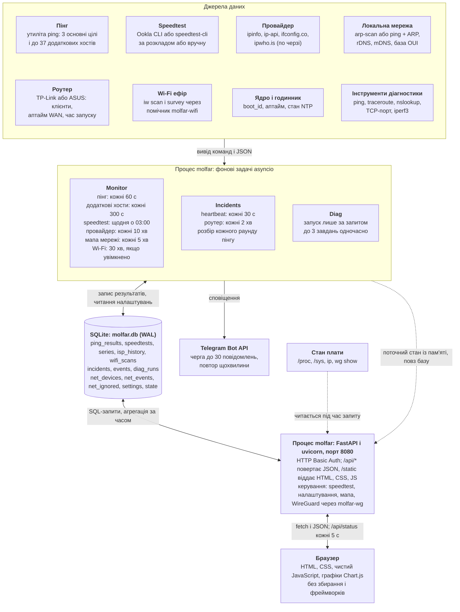

**Українська** | [English](ARCHITECTURE.md)

# Мольфар: архітектура

## Загальна схема

Мольфар складається з одного процесу Python і одного файлу SQLite. У цьому процесі працюють і фонові задачі, які збирають виміри, і веб-сервер, який їх показує, тому окремих воркерів, брокера повідомлень чи сервера бази даних немає.

Опис зроблено за кодом гілки `main` (коміт `3bbf722` від 4 листопада 2026 року) для `advanced-version`. Відмінності інших версій наведено в кінці.

Головний шлях даних іде зверху вниз: зовнішня команда або сервіс, фонова задача, таблиця SQLite, запит API, графік у браузері. Є два винятки. Поточний стан (останній пінг, хід серії, час наступної перевірки) API бере прямо з пам'яті процесу, а температуру, пам'ять і стан WireGuard зчитує в момент запиту, тому вони в базу не потрапляють.

## Звідки беруться дані

Власних драйверів чи мережевих протоколів у сервісі майже немає: він запускає системні утиліти без shell і розбирає їхній вивід або звертається до зовнішніх сервісів. Модуль у таблиці вказано відносно теки `molfar/molfar/`.

| Дані | Джерело | Як отримуються | Модуль |
| --- | --- | --- | --- |
| Втрати, RTT, джитер | Утиліта `ping` | `ping -n -c 20 -i 0.2 -W 2`; вивід розбирається регулярними виразами. Джитер рахується як середня абсолютна різниця сусідніх RTT | `probes.py` |
| Швидкість | Ookla CLI або `speedtest-cli` | Запуск із JSON-виводом. Рушій `auto` вибирає Ookla, якщо вона встановлена. Ookla віддає й джитер та втрати, `speedtest-cli` їх не вимірює | `probes.py` |
| Провайдер, зовнішній IP, ASN | ipinfo.io, ip-api.com, ifconfig.co, ipwho.is | HTTP-запити по черзі до першої успішної відповіді. Провайдер порівнюється за ASN, зміна підтверджується повторною перевіркою через 20 с | `isp.py` |
| Пристрої в локальній мережі | `arp-scan`, запасний варіант `ping` і `ip neigh` | Сканування підмережі (не більше /22), імена через rDNS і mDNS, виробник за базою OUI, тип пристрою вгадується за виробником та іменем | `netscan.py`, `netmap.py` |
| Клієнти роутера | TP-Link (`tplinkrouterc6u`), ASUS (`asusrouter`) | Вхід в API роутера: список клієнтів за діапазонами, час запуску (ASUS) або аптайм WAN (TP-Link). У README ця функція позначена як ще не протестована | `routers.py` |
| Сусідні Wi-Fi мережі | `iw scan`, `iw survey dump` | Через root-помічник `molfar-wifi`; без нього використовується кеш ядра `scan dump`. Спектр моделюється, а не вимірюється: за RSSI кожної мережі, ширини смуги й маски 802.11 OFDM | `wifi.py` |
| Температура, пам'ять, диск, IP | `/sys/class/thermal`, `/proc`, `ip addr` | Читається під час запиту `/api/status` | `sysinfo.py` |
| Стан WireGuard | `wg show all dump` | Читається під час запиту, кеш 15 с | `sysinfo.py` |
| Перезавантаження й простій | `/proc/sys/kernel/random/boot_id`, `/proc/uptime`, `adjtimex` | Порівняння `boot_id` зі збереженим значенням і перевірка синхронізації часу | `incidents.py` |
| Діагностика | `ping`, `traceroute`, `nslookup`, TCP-з'єднання, `iperf3` | Лише на запит користувача, вивід передається наживо | `diag.py` |

## Як дані потрапляють у базу

Під час старту `app.py` створює об'єкти `DB`, `Monitor`, `Auth` і `Diag`, а `Monitor.start()` запускає дев'ять фонових циклів asyncio в одному циклі подій із веб-сервером. Кожен цикл заново читає налаштування з бази, тому зміни з веб-інтерфейсу діють без перезапуску. Блокуючі операції (сканування мережі, Wi-Fi, HTTP-запити до провайдерів) виконуються в окремих потоках.

| Цикл | Типовий інтервал | Що записує | Куди |
| --- | --- | --- | --- |
| `_ping_loop` | 60 с | По одному рядку на кожну основну ціль і хост «На Огляді» | `ping_results` |
| `_ping_extra_loop` | 300 с | Те саме для решти додаткових хостів, до 10 одночасних ping | `ping_results` |
| `_schedule_loop` | Перевірка що 20 с, запуск щодня о 03:00 | Серію з 5 тестів із паузою 5 хв | `series`, `speedtests` |
| `_isp_loop` | 10 хв | Запис лише при першому визначенні або зміні провайдера чи IP; поточне значення оновлюється щоразу | `isp_history`, `state` |
| `_netmap_loop` | 5 хв | Злиття сканування з мапою в одній транзакції | `net_devices`, `net_events` |
| `_wifi_loop` | 30 хв, за замовчуванням вимкнено | Знімок ефіру та оцінки каналів у JSON | `wifi_scans` |
| `heartbeat_loop` | 30 с | Час і `boot_id` | `state` |
| `router_loop` | 2 хв, якщо роутер налаштовано | Збої роутера і відвали Wi-Fi; самі клієнти лишаються в пам'яті | `incidents` |
| `_maintenance_loop` | 60 с | Досилає чергу Telegram, кожні 6 годин видаляє старі записи | видалення |

### Пінг

1. `ping_round` одночасно пінгує всі цілі через `probes.ping_target`.
2. Кожен результат записується в `ping_results` і в `last_ping` у пам'яті, звідки береться плитка на «Огляді».
3. `_check_loss_alerts` перевіряє поріг втрат і за потреби ставить сповіщення в чергу.
4. `inc.on_ping` оцінює основні цілі і відкриває або закриває інцидент `internet`.

За замовчуванням під час speedtest пінг ставиться на паузу, щоб навантаження не виглядало як втрати.

### Speedtest

1. `start_series` створює рядок у `series` зі статусом `running`.
2. Кожен тест додає рядок у `speedtests`, навіть невдалий: тоді заповнюється поле `error`. Якщо вибраний сервер недоступний, тест повторюється з автовибором.
3. `_finish_series` рахує середнє за успішними тестами і оновлює рядок серії.

Щоб серія не запустилась двічі за добу, дата останнього запуску зберігається в `state`. Запуск можливий у 15-хвилинному вікні після визначеного часу, тож короткий перезапуск сервісу серію не зриває. Серії, що залишилися `running` після аварії, під час старту позначаються як `stopped`.

### Мапа мережі

Пристрій ідентифікується за MAC-адресою. `apply_scan` додає нові пристрої, фіксує зміну IP і переходи онлайн та офлайн, але не чіпає поля, заблоковані користувачем. Пристрій стає офлайн через 15 хв без відповіді, а через 7 днів офлайн зникає з мапи: рядок лишається в базі з `hidden=1`.

### Інші записи

- **Налаштування:** `POST /api/settings` перевіряє типи й межі значень і зберігає кожен ключ окремим рядком. Ключі, яких немає в базі, беруться з `DEFAULTS` у `db.py`.
- **Журнал:** `db.log()` додає рядок у `events` мовою інтерфейсу на момент події.
- **Діагностика:** поточний вивід тримається в пам'яті, а після завершення підсумок і до 64 КБ виводу записуються в `diag_runs`.

Усі модулі працюють із одним файлом у режимі WAL. Клас `DB` має одне з'єднання, захищене блокуванням потоків, і фіксує кожен запис окремо; мапа мережі має власне з'єднання і транзакції.

## Структура бази даних

База це один файл SQLite, шлях задає `MOLFAR_DB` (типово `/var/lib/molfar/molfar.db`). Таблиці створюються під час старту через `CREATE TABLE IF NOT EXISTS`, а нові колонки додає `_migrate()`, тому оновлення не втрачає дані. Час у більшості таблиць зберігається як Unix-час у секундах.

| Таблиця | Що зберігає | Хто пише | Скільки живе |
| --- | --- | --- | --- |
| `ping_results` | Одна перевірка однієї цілі | `monitor.py` | 400 днів |
| `series` | Серія speedtest і середні значення | `monitor.py` | 400 днів |
| `speedtests` | Один тест швидкості | `monitor.py` | 400 днів |
| `isp_history` | Зміни провайдера і зовнішнього IP | `monitor.py` | Не очищується |
| `incidents` | Збої з початком і кінцем | `incidents.py` | Закриті: 400 днів |
| `events` | Журнал подій сервісу | Усі модулі через `db.log()` | 400 днів |
| `net_devices` | Пристрої мапи мережі | `netmap.py` | Приховується через 7 днів офлайн |
| `net_events` | Журнал мапи: новий пристрій, зміна IP, онлайн, офлайн | `netmap.py` | 400 днів |
| `net_ignored` | MAC-адреси, які не показувати | `netmap.py` | До видалення вручну |
| `wifi_scans` | Знімок ефіру | `wifi.py` | 30 днів |
| `diag_runs` | Історія діагностики | `diag.py` | Останні 200 записів |
| `settings` | Налаштування, значення в JSON | `app.py` | Постійно |
| `state` | Внутрішній стан, значення в JSON | Усі модулі | Постійно |

Терміни 400, 30 днів і 7 днів типові та змінюються в налаштуваннях.

### Колонки

| Таблиця | Колонки |
| --- | --- |
| `ping_results` | `id`, `ts`, `target`, `sent`, `received`, `loss`, `rtt_min`, `rtt_avg`, `rtt_max`, `jitter`, `error` |
| `series` | `id`, `started_ts`, `finished_ts`, `trigger`, `status`, `runs_planned`, `runs_ok`, `avg_download`, `avg_upload`, `avg_ping`, `avg_jitter` |
| `speedtests` | `id`, `ts`, `series_id`, `download`, `upload`, `ping`, `jitter`, `packet_loss`, `server`, `engine`, `url`, `error`, `isp`, `external_ip` |
| `isp_history` | `id`, `ts`, `kind`, `ip`, `asn`, `isp`, `org`, `city`, `country`, `source` |
| `incidents` | `id`, `kind`, `started_ts`, `ended_ts`, `details` (JSON) |
| `events` | `id`, `ts`, `level`, `message` |
| `net_devices` | `id`, `mac`, `ip`, `name`, `name_auto`, `kind`, `kind_locked`, `vendor`, `vendor_locked`, `private_mac`, `vlan`, `link`, `link_locked`, `parent_id`, `ssid`, `band`, `note`, `role`, `manual`, `keep`, `status`, `hidden`, `pos_x`, `pos_y`, `first_seen`, `last_seen`, `status_since` |
| `net_events` | `id`, `ts`, `device_id`, `mac`, `name`, `kind`, `type`, `params` (JSON) |
| `net_ignored` | `mac`, `name`, `ts` |
| `wifi_scans` | `id`, `ts`, `iface`, `cached`, `n_bss`, `scores`, `bss`, `survey` (останні три в JSON) |
| `diag_runs` | `id`, `ts`, `tool`, `target`, `params`, `status`, `duration`, `summary`, `output` |
| `settings`, `state` | `key`, `value` (JSON) |

Унікальність має лише `net_devices.mac`.

### Зв'язки

Між таблицями майже немає зв'язків, бо це незалежні журнали, упорядковані за часом. Зовнішній ключ оголошено лише для `speedtests.series_id` → `series.id`. Ще два зв'язки підтримує код: `net_devices.parent_id` → `net_devices.id` (дерево топології) і `net_events.device_id` → `net_devices.id`.

### Що лежить у `state`

| Ключ | Призначення |
| --- | --- |
| `heartbeat`, `clean_stop` | Облік простою Мольфара |
| `last_schedule_date` | Дата останньої серії за розкладом |
| `isp_current` | Поточний провайдер |
| `netmap_seeded` | Перше сканування вже було, далі можна повідомляти про нові пристрої |
| `auth_hash` | Хеш пароля, зміненого у веб-інтерфейсі |
| `diag_iperf_server` | Чи відновлювати iperf3-сервер після перезапуску |

Попередньої агрегації немає: у базі лежать сирі виміри, а середні для графіків рахуються під час запиту.

## Веб-інтерфейс і API

**Сервер.** FastAPI під uvicorn слухає типово `0.0.0.0:8080`, віддає JSON на `/api/*` і файли з `static/`. Автоматична документація OpenAPI вимкнена.

**Клієнт.** Це одна сторінка `index.html` із вкладками, написана без фреймворків і без збирання. Графіки малює Chart.js із локальної копії в `static/vendor`, тому інтерфейс не залежить від CDN і працює без інтернету. Переклади лежать у `i18n.js`, повідомлення сервера в `i18n.py`.

**Оновлення даних.** WebSocket і SSE не використовуються: браузер опитує API через `fetch`. Оновлення «Огляду», «Історії» та «Інцидентів» призупиняється, коли вкладка браузера прихована.

| Вкладка | Запити | Оновлення | Звідки дані |
| --- | --- | --- | --- |
| Огляд | `GET /api/status` | 5 с | Пам'ять `Monitor`, `/proc`, `wg`, останні рядки `series` і `speedtests`, інциденти за добу |
| Історія | `/api/history/ping`, `/api/history/speed`, `/api/isp` | 60 с | `ping_results`, `speedtests`, `series`, `isp_history` |
| Інциденти | `/api/incidents` | 30 с | `incidents`, підсумки рахує Python |
| WireGuard | `/api/wg/profiles` | Під час відкриття і після дій | `/etc/wireguard` через помічник `molfar-wg` |
| Мапа мережі | `/api/netmap`, `/api/netmap/events` | 15 с, під час сканування 3 с | `net_devices`, `net_events`, `net_ignored` |
| Wi-Fi ефір | `/api/wifi`, `/api/wifi/history` | Під час сканування 2,5 с | `wifi_scans`; аналіз каналів у `wifi.py` |
| Діагностика | `/api/diag`, `/api/diag/jobs/{id}?since=N` | 0,6–1 с під час завдання | Пам'ять `Diag`, історія в `diag_runs` |
| Налаштування | `GET` і `POST /api/settings` | Під час відкриття | `settings` |
| Журнал | `/api/events` | Під час відкриття | `events` |

### Як будується графік історії

`/api/history/ping` групує сирі рядки у часові кошики SQL-запитом із врахуванням часового поясу і повертає середні втрати, RTT і джитер для кожної цілі, а також підсумок за період.

| Період | Розмір кошика |
| --- | --- |
| Доба | 5 хв |
| Тиждень | 1 година |
| Місяць | 4 години |
| Рік | 1 доба |

`/api/history/speed` віддає тести і серії без групування.

### Від кнопки до дії

- **Запуск і зупинка speedtest:** `POST /api/speedtest/start` і `/stop`.
- **Ручний пінг:** `POST /api/ping/run`. Результат пишеться в базу, але не впливає на сповіщення і інциденти.
- **Редагування мапи:** `POST`, `PATCH` і `DELETE /api/netmap/devices`.
- **Експорт у CSV:** `/api/export/{ping|speed|incidents}.csv`.

Після зміни налаштувань API відразу будить потрібні цикли через `asyncio.Event`, не чекаючи їхнього інтервалу.

Кеш браузера керується хешем: `/` додає до JS і CSS параметр `?v=<хеш>`, такі файли кешуються на рік, а `/api/*` не кешується зовсім.

## Інциденти і сповіщення

| Тип | Коли відкривається | Що фіксує |
| --- | --- | --- |
| `internet` | Усі публічні основні цілі не відповіли 2 перевірки поспіль | Причину за пінгом шлюзу: `isp` (шлюз відповідає), `lan` (не відповідає), `nolink` (немає маршруту) |
| `molfar` | Записується під час старту, якщо був попередній heartbeat | Причину: `power`, `reboot`, `restart`, `crash` |
| `router` | 2 невдалі опитування поспіль або виявлений перезапуск | Недоступність, перезавантаження, перепідключення WAN |
| `wifi` | Між двома опитуваннями зникли всі Wi-Fi клієнти, а до цього їх було не менше 2 | Скільки клієнтів втрачено за діапазонами |

**Як визначається простій Мольфара.** Сервіс кожні 30 с зберігає час і `boot_id`, а під час штатної зупинки ще й `clean_stop`. Після старту ці два признаки дають причину:

| | `clean_stop` є | `clean_stop` немає |
| --- | --- | --- |
| `boot_id` змінився | `reboot` | `power` |
| `boot_id` той самий | `restart` | `crash` |

Orange Pi Zero 3 не має батарейки годинника, тому після перезавантаження сервіс чекає синхронізації NTP до 6 годин, а час початку відкритих інцидентів відновлює за монотонним годинником.

**Telegram.** Сповіщення йдуть напряму в Bot API через `urllib`. За замовчуванням вони вимкнені. Черга тримає до 30 повідомлень лише в пам'яті: без інтернету сервіс повторює спробу щохвилини, але після перезапуску черга втрачається. Поріг втрат типово 10% у 3 перевірках поспіль, мінімум 30 хв між алертами.

## Безпека

- **Вхід:** HTTP Basic Auth на всі запити, логін `admin`, типовий пароль `Molfar`. Змінений пароль зберігається як хеш PBKDF2-SHA256.
- **Права:** сервіс працює від користувача `molfar` із `CAP_NET_RAW`. Дії root можливі лише через `sudo -n` і правило в `/etc/sudoers.d/molfar`: `wg show all dump`, `molfar-wg`, `molfar-wifi`.
- **Помічники:** `molfar-wg` сам перевіряє аргументи і забороняє `PostUp` та подібні ключі. Зміна профілю відкочується через 60 с без підтвердження, щоб не втратити доступ.
- **Команди:** утиліти запускаються списком аргументів без shell, адреси перевіряються регулярними виразами.

### Що варто врахувати

Це спостереження з коду, на працюючому пристрої вони не перевірялись.

- Сервіс працює через HTTP без TLS і типово слухає всі інтерфейси, тому пароль Basic Auth передається без шифрування. Безпечніше заходити через WireGuard і не відкривати порт в інтернет.
- Токен Telegram і пароль роутера лежать у `settings` відкритим текстом. API їх маскує, але файл бази і його резервні копії треба захищати.
- `cleanup()` не видаляє старі рядки `isp_history`, хоча ця таблиця росте повільно.
- Запасний запит до ip-api.com йде через незахищений HTTP.

## Розгортання

| | На платі (`install.sh`) | У Docker |
| --- | --- | --- |
| Запуск | systemd, `molfar.service` | `docker compose`, tini як PID 1 |
| Код | `/opt/molfar`, віртуальне середовище Python | Образ на Debian trixie-slim, x86_64 або ARM64 |
| Дані | `/var/lib/molfar` | Том `./data` |
| Профілі VPN | `/etc/wireguard` | Том `./wireguard` |
| Налаштування запуску | `/etc/molfar.env` | `.env` |
| Мережа | Мережа хоста | `network_mode: host` |
| Права | Користувач `molfar`, `CAP_NET_RAW`, sudo | root у контейнері, лише `NET_RAW` і `NET_ADMIN` |
| Тунелі | `wg-quick@` у systemd | `svc-shim` замінює `systemctl`, `systemd-run`, `journalctl` |

Зовнішні Python-залежності: `fastapi`, `uvicorn`, `speedtest-cli`, а в розширеній версії ще `tplinkrouterc6u` і `asusrouter`.

## Версії в репозиторії

| Тека | Відмінність |
| --- | --- |
| `basic-version` | Немає інцидентів, Wi-Fi ефіру і опитування роутерів: без модулів `incidents.py`, `routers.py`, `wifi.py`, таблиць `incidents` і `wifi_scans`, шість фонових циклів замість дев'яти |
| `advanced-version` | Усе описане вище |
| `advanced-version_docker` | Той самий код і `static`, що в `advanced-version`, плюс `Dockerfile`, `docker-compose.yml` і тека `docker/` |
